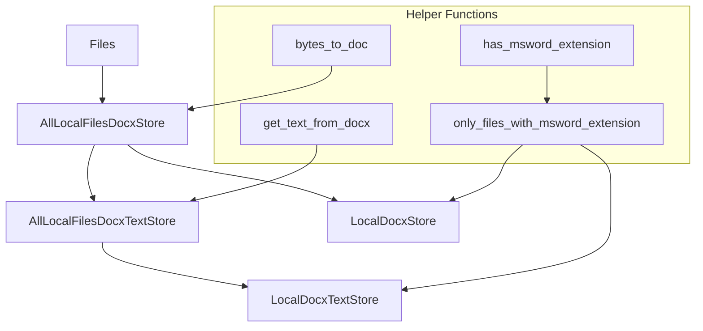

# msword.base

Module for Managing Local MS Word Documents

This module provides a collection of functions and classes designed to manage
MS Word files stored locally. It leverages the `dol` framework to wrap local
binary file stores and integrates the python-docx library for handling the
content of MS Word documents. The module supports both retrieving full
`docx.Document` objects and extracting plain text from documents.

Main Classes:

> - AllLocalFilesDocxStore:
>   : A wrapper around a local binary store (derived from `dol`’s Files)
>     that returns the content of files as `docx.Document` objects. This class does not
>     filter files by their extension, so it may raise errors if non-MS Word files are encountered.
> - AllLocalFilesDocxTextStore:
>   : Extends AllLocalFilesDocxStore by applying the `get_text_from_docx` function,
>     returning plain text extracted from each document instead of the full document object.
> - LocalDocxStore:
>   : Inherits from AllLocalFilesDocxStore and applies the `only_files_with_msword_extension`
>     filter, ensuring that only files with valid MS Word extensions (‘.doc’ and ‘.docx’) are processed.
>     It returns `docx.Document` objects.
> - LocalDocxTextStore:
>   : Similar to LocalDocxStore, this class extends AllLocalFilesDocxTextStore and filters for
>     valid MS Word files. It returns the extracted text from the documents.

Helper Functions:

> - \_extension(k: str):
>   : Extracts the file extension from a filename (key) by splitting on dots.
> - has_msword_extension(k: str):
>   : Returns True if the key has a recognized MS Word extension (‘.doc’ or ‘.docx’).
> - only_files_with_msword_extension(store):
>   : Filters the keys of a store to include only those with valid MS Word extensions.
> - \_remove_docx_extension(k: str) and \_add_docx_extension(k: str):
>   : Utility functions to remove or add the default ‘.docx’ extension to keys.
> - paragraphs_text(doc):
>   : A generator function that yields the text of each paragraph in a document.
> - get_text_from_docx(doc, paragraph_sep=’

‘):
: > Concatenates the text from all paragraphs in a `docx.Document` object using
  > the specified separator.
  - bytes_to_doc(doc_bytes):
    : Converts a bytes stream to a `docx.Document` object using an in-memory buffer.

The relationships and dependencies between the main objects and helper functions are
illustrated in the following mermaid graph:



### Functions

| `bytes_to_doc`(doc_bytes)                                                                 |                                                                                    |
|-------------------------------------------------------------------------------------------|------------------------------------------------------------------------------------|
| [`extension_less_keys`](#msword.base.extension_less_keys)(store)               | Will filter keys to only include .docx files, and not show that extension in keys. |
| [`get_text_from_docx`](#msword.base.get_text_from_docx)(doc[, paragraph_sep]) | Get text from docx.Document object.                                                |
| `has_msword_extension`(k)                                                                 |                                                                                    |
| `only_files_with_msword_extension`(store)                                                 |                                                                                    |
| `paragraphs_text`(doc)                                                                    |                                                                                    |

### Classes

| [`AllLocalFilesDocxStore`](#msword.base.AllLocalFilesDocxStore)(\*args[, delete_func, ...])   | Local files store returning, as values, `docx.document.Document` objects.   |
|-------------------------------------------------------------------------------------------------------|-----------------------------------------------------------------------------|
| [`AllLocalFilesDocxTextStore`](#msword.base.AllLocalFilesDocxTextStore)(\*args[, ...])            | Local files store returning, as values, text extracted from the documents.  |
| [`LocalDocxStore`](#msword.base.LocalDocxStore)(\*args[, delete_func, ...])           | Local files store returning, as values, docx objects.                       |
| [`LocalDocxTextStore`](#msword.base.LocalDocxTextStore)(\*args[, delete_func, ...])       | Local files store returning, as values, text extracted from the documents.  |

### *class* msword.base.AllLocalFilesDocxStore(\*args, delete_func=None, write_open_kwargs=None, write_func=None, \*\*kwargs)

Bases: `Store`

Local files store returning, as values, `docx.document.Document` objects.

#### NOTE
Doesn’t filter for valid msword extensions (.doc and .docx), so could raise errors.
To filter for valid extensions, use LocalDocxStore instead.

#### is_valid_key(k, \*args, \_\_name='is_valid_key', \*\*kwargs)

`is_valid_key` on the inner key – see `mk_relative_path_store`.

#### validate_key(k, \*args, \_\_name='validate_key', \*\*kwargs)

`validate_key` on the inner key – see `mk_relative_path_store`.

### *class* msword.base.AllLocalFilesDocxTextStore(\*args, delete_func=None, write_open_kwargs=None, write_func=None, \*\*kwargs)

Bases: `Store`

Local files store returning, as values, text extracted from the documents.

#### NOTE
Doesn’t filter for valid msword extensions (.doc and .docx), so could raise errors.
To filter for valid extensions, use LocalDocxTextStore instead.

#### is_valid_key(k, \*args, \_\_name='is_valid_key', \*\*kwargs)

`is_valid_key` on the inner key – see `mk_relative_path_store`.

#### validate_key(k, \*args, \_\_name='validate_key', \*\*kwargs)

`validate_key` on the inner key – see `mk_relative_path_store`.

### *class* msword.base.LocalDocxStore(\*args, delete_func=None, write_open_kwargs=None, write_func=None, \*\*kwargs)

Bases: `Store`

Local files store returning, as values, docx objects.

#### NOTE
Filters for valid msword extensions (.doc and .docx).
To NOT filter for valid extensions, use AllLocalFilesDocxStore instead.

```pycon
>>> from msword import LocalDocxStore, test_data_dir
>>> import docx
>>> s = LocalDocxStore(test_data_dir)
>>> assert {'with_doc_extension.doc', 'simple.docx'}.issubset(s)
>>> v = s['with_doc_extension.doc']
>>> assert isinstance(v, docx.document.Document)
```

What does a `docx.document.Document` have to offer?
If you really want to get into it, see here: [https://python-docx.readthedocs.io/en/latest/](https://python-docx.readthedocs.io/en/latest/)

Meanwhile, we’ll give a few examples here as an amuse-bouche.

```pycon
>>> ddir = lambda x: set([xx for xx in dir(x) if not xx.startswith('_')])  # to see what an object has
>>> assert ddir(v).issuperset({
...     'add_heading', 'add_page_break', 'add_paragraph', 'add_picture', 'add_section', 'add_table',
...     'core_properties', 'element', 'inline_shapes', 'paragraphs', 'part',
...     'save', 'sections', 'settings', 'styles', 'tables'
... })
```

`paragraphs` is where the main content is, so let’s have a look at what it has.

```pycon
>>> len(v.paragraphs)
21
>>> paragraph = v.paragraphs[0]
>>> assert ddir(paragraph).issuperset({
...     'add_run', 'alignment', 'clear', 'insert_paragraph_before',
...     'paragraph_format', 'part', 'runs', 'style', 'text'
... })
>>> paragraph.text
'Section 1'
>>> assert ddir(paragraph.style).issuperset({
...     'base_style', 'builtin', 'delete', 'element', 'font', 'hidden', 'locked', 'name', 'next_paragraph_style',
...     'paragraph_format', 'part', 'priority', 'quick_style', 'style_id', 'type', 'unhide_when_used'
... })
>>> paragraph.style.style_id
'Heading1'
>>> paragraph.style.font.color.rgb
RGBColor(0x2f, 0x54, 0x96)
```

You get the point…

If you’re only interested in one particular aspect of the documents, you should your favorite
`dol` wrappers to get the store you really want. For example:

```pycon
>>> from dol import wrap_kvs
>>> ss = wrap_kvs(s, value_decoder=lambda doc: [paragraph.style.style_id for paragraph in doc.paragraphs])
>>> assert ss['with_doc_extension.doc'] == [
...     'Heading1', 'Normal', 'Normal', 'Heading2', 'Normal', 'Normal',
...     'Heading1', 'Normal', 'Normal', 'Normal', 'Normal', 'Normal', 'Normal', 'Normal',
...     'ListParagraph', 'ListParagraph', 'Normal', 'Normal', 'ListParagraph', 'ListParagraph', 'Normal'
... ]
```

The most common use case is probably getting text, not styles, out of a document.
It’s so common, that we’ve done the wrapping for you:
Just use the already wrapped LocalDocxTextStore store for that purpose.

#### get(k) → D[k] if k in D, else d.  d defaults to None.

#### is_valid_key(k, \*args, \_\_name='is_valid_key', \*\*kwargs)

`is_valid_key` on the inner key – see `mk_relative_path_store`.

#### validate_key(k, \*args, \_\_name='validate_key', \*\*kwargs)

`validate_key` on the inner key – see `mk_relative_path_store`.

### *class* msword.base.LocalDocxTextStore(\*args, delete_func=None, write_open_kwargs=None, write_func=None, \*\*kwargs)

Bases: `Store`

Local files store returning, as values, text extracted from the documents.
Use this when you just want the text contents of the document.
If you want more, you’ll need to user LocalDocxStore with the appropriate content extractor
(i.e. the value_decoder function in a `dol.wrap_kvs` wrapper).

#### NOTE
Filters for valid msword extensions (.doc and .docx).
To Note filter for valid extensions, use AllLocalFilesDocxTextStore instead.

```pycon
>>> from msword import LocalDocxTextStore, test_data_dir
>>> import docx
>>> s = LocalDocxTextStore(test_data_dir)
>>> assert {'with_doc_extension.doc', 'simple.docx'}.issubset(s)
>>> v = s['simple.docx']
>>> assert isinstance(v, str)
>>> print(v)
Just a bit of text to show that is works. Another sentence.
This is after a newline.

This is after two newlines.
```

#### get(k) → D[k] if k in D, else d.  d defaults to None.

#### is_valid_key(k, \*args, \_\_name='is_valid_key', \*\*kwargs)

`is_valid_key` on the inner key – see `mk_relative_path_store`.

#### validate_key(k, \*args, \_\_name='validate_key', \*\*kwargs)

`validate_key` on the inner key – see `mk_relative_path_store`.

### msword.base.extension_less_keys(store)

Will filter keys to only include .docx files, and not show that extension in keys.

#### NOTE
Should not be used along with only_files_with_msword_extension;
extension_less_keys already does its own key filtering.

```text
list(store)  # == ['this.docx', 'is.doc', 'an.pdf', 'example.docx']
s = extension_less_keys(store)
list(s)  # # == ['this', 'example']
```

### msword.base.get_text_from_docx(doc, paragraph_sep='\\n')

Get text from docx.Document object.
More precisely, ‘text’ will be the concatenation of the .text attributes of every paragraph.
