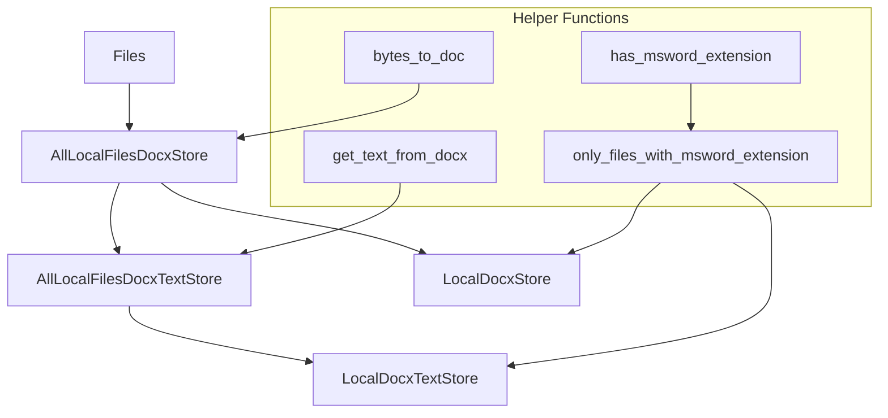

> built 2026-11-23 02:44 UTC from d21bb44 (master) · msword 0.0.8. Details: build_info.json

# index.html.md

<!-- generated by epythet -->

# msword

A mapping view of a folder of Word documents: `store[filename]` gives you the text, or the full `docx.Document`, of that file.

```bash
pip install msword
```

- [Quick Start]()
- [LocalDocxTextStore]()
- [LocalDocxStore]()
- [Package Architecture]()
  - [Main Classes]()
  - [Helper Functions]()
  - [Mapping Wrappers]()
- [Mermaid Graphs]()
- [License]()

---

## Quick Start

For users who just want to extract text from a collection of local MS Word documents, the simplest approach is to use the `LocalDocxTextStore`. The following example demonstrates how to create a text store from a folder containing MS Word files and access the text content of a document:

```python
from msword import LocalDocxTextStore
from msword.tests.util import test_data_dir  # Directory with test data

# Create a text store that extracts and returns text from MS Word documents.
docs_text_content = LocalDocxTextStore(test_data_dir)

# List the available document keys (filtered to valid MS Word files).
print(sorted(docs_text_content))

# Access the text of a specific document.
print(docs_text_content['simple.docx'])
```

For users needing the full `docx.Document` objects for more advanced processing (e.g., modifying document structure, styling, etc.), use the `LocalDocxStore`:

```python
from msword import LocalDocxStore
from msword.tests.util import test_data_dir
import docx

store = LocalDocxStore(test_data_dir)
doc = store['with_doc_extension.doc']
assert isinstance(doc, docx.document.Document)
print(doc.paragraphs[0].text)
```

## LocalDocxTextStore

Local files store returning, as values, text extracted from the documents. Use this when you just want the text contents of the document. If you want more, you’ll need to user `LocalDocxStore` with the appropriate content extractor (i.e. the value_decoder function in a `dol.wrap_kvs` wrapper).

Note: Filters for valid msword extensions (.doc and .docx). To NOT filter for valid extensions, use `AllLocalFilesDocxTextStore` instead.

```python
>>> from msword import LocalDocxTextStore, test_data_dir
>>> import docx
>>> s = LocalDocxTextStore(test_data_dir)
>>> assert {'with_doc_extension.doc', 'simple.docx'}.issubset(s)
>>> v = s['simple.docx']
>>> assert isinstance(v, str)
>>> print(v)
Just a bit of text to show that is works. Another sentence.
This is after a newline.

This is after two newlines.
```

## LocalDocxStore

Local files store returning, as values, docx objects. Note: Filters for valid msword extensions (.doc and .docx). To Note filter for valid extensions, use `AllLocalFilesDocxStore` instead.

```python
>>> from msword import LocalDocxStore, test_data_dir
>>> import docx
>>> s = LocalDocxStore(test_data_dir)
>>> assert {'with_doc_extension.doc', 'simple.docx'}.issubset(s)
>>> v = s['with_doc_extension.doc']
>>> assert isinstance(v, docx.document.Document)
```

What does a `docx.document.Document` have to offer? If you really want to get into it, see here: https://python-docx.readthedocs.io/en/latest/

Meanwhile, we’ll give a few examples here as an amuse-bouche.

```python
>>> ddir = lambda x: set([xx for xx in dir(x) if not xx.startswith('_')])  # to see what an object has
>>> assert ddir(v).issuperset({
...     'add_heading', 'add_page_break', 'add_paragraph', 'add_picture', 'add_section', 'add_table',
...     'core_properties', 'element', 'inline_shapes', 'paragraphs', 'part',
...     'save', 'sections', 'settings', 'styles', 'tables'
... })
```

`paragraphs` is where the main content is, so let’s have a look at what it has.

```python
>>> len(v.paragraphs)
21
>>> paragraph = v.paragraphs[0]
>>> assert ddir(paragraph).issuperset({
...     'add_run', 'alignment', 'clear', 'insert_paragraph_before',
...     'paragraph_format', 'part', 'runs', 'style', 'text'
... })
>>> paragraph.text
'Section 1'
>>> assert ddir(paragraph.style).issuperset({
...     'base_style', 'builtin', 'delete', 'element', 'font', 'hidden', 'locked', 'name', 'next_paragraph_style',
...     'paragraph_format', 'part', 'priority', 'quick_style', 'style_id', 'type', 'unhide_when_used'
... })
>>> paragraph.style.style_id
'Heading1'
>>> paragraph.style.font.color.rgb
RGBColor(0x2f, 0x54, 0x96)
```

You get the point…

If you’re only interested in one particular aspect of the documents, you should your favorite `dol` wrappers to get the store you really want. For example:

```python
>>> from dol import wrap_kvs
>>> ss = wrap_kvs(s, value_decoder=lambda doc: [paragraph.style.style_id for paragraph in doc.paragraphs])
>>> assert ss['with_doc_extension.doc'] == [
...     'Heading1', 'Normal', 'Normal', 'Heading2', 'Normal', 'Normal',
...     'Heading1', 'Normal', 'Normal', 'Normal', 'Normal', 'Normal', 'Normal', 'Normal',
...     'ListParagraph', 'ListParagraph', 'Normal', 'Normal', 'ListParagraph', 'ListParagraph', 'Normal'
... ]
```

The most common use case is probably getting text, not styles, out of a document. It’s so common, that we’ve done the wrapping for you: Just use the already wrapped LocalDocxTextStore store for that purpose.

---

## Package Architecture

The module is built around a set of core classes and helper functions. Its functionality is entirely defined by the combination of a base file store (from `dol.Files`) and a set of decorators that wrap the store to transform its values.

### Main Classes

- **AllLocalFilesDocxStore** A wrapper around a local file store that returns file contents as `docx.Document` objects. This class does not filter file extensions, meaning that non-MS Word files might cause errors.
- **AllLocalFilesDocxTextStore** Inherits from `AllLocalFilesDocxStore` and applies a text extraction function (`get_text_from_docx`). It returns the concatenated text of all paragraphs in the document.
- **LocalDocxStore** Extends `AllLocalFilesDocxStore` and uses the `only_files_with_msword_extension` decorator to filter out files that do not have valid MS Word extensions (i.e., `.doc` or `.docx`).
- **LocalDocxTextStore** Extends `AllLocalFilesDocxTextStore` and applies the same file filtering as `LocalDocxStore`, ensuring that only valid MS Word files are processed.

### Helper Functions

- **\_extension(k: str)** Splits a filename and returns its extension.
- **has_msword_extension(k: str)** Checks if a filename has a valid MS Word extension (`doc` or `docx`).
- **\_remove_docx_extension(k: str) & \_add_docx_extension(k: str)** Utilities to remove or add the default `.docx` extension to keys.
- **paragraphs_text(doc)** Yields the text from each paragraph of a `docx.Document`.
- **get_text_from_docx(doc, paragraph_sep=’\\n’)** Concatenates all paragraph texts from a document using the specified separator.
- **bytes_to_doc(doc_bytes: bytes)** Converts raw bytes into a `docx.Document` using an in-memory buffer.

### Mapping Wrappers

- **with_bytes_to_doc_decoding** Wraps a mapping to convert byte values into `docx.Document` objects.
- **with_doc_to_text_decoding** Wraps a mapping to convert `docx.Document` objects into text.
- **with_bytes_to_text_decoding** Combines the two above by first converting bytes into a document and then extracting its text.
- **only_files_with_msword_extension** Filters the keys of a store so that only those with valid MS Word extensions are processed.

---

## Mermaid Graphs

### Overall Object Relationships

### Mapping Wrappers Pipeline

---

## License

This module is distributed under the terms of the MIT license.

<p class="epythet-aggregates">This documentation as a single file: <a href="msword.md">msword.md</a> (Markdown, for agents).</p>


# _autosummary/msword.base.html.md

# msword.base

Module for Managing Local MS Word Documents

This module provides a collection of functions and classes designed to manage
MS Word files stored locally. It leverages the `dol` framework to wrap local
binary file stores and integrates the python-docx library for handling the
content of MS Word documents. The module supports both retrieving full
`docx.Document` objects and extracting plain text from documents.

Main Classes:

> - AllLocalFilesDocxStore:
>   : A wrapper around a local binary store (derived from `dol`’s Files)
>     that returns the content of files as `docx.Document` objects. This class does not
>     filter files by their extension, so it may raise errors if non-MS Word files are encountered.
> - AllLocalFilesDocxTextStore:
>   : Extends AllLocalFilesDocxStore by applying the `get_text_from_docx` function,
>     returning plain text extracted from each document instead of the full document object.
> - LocalDocxStore:
>   : Inherits from AllLocalFilesDocxStore and applies the `only_files_with_msword_extension`
>     filter, ensuring that only files with valid MS Word extensions (‘.doc’ and ‘.docx’) are processed.
>     It returns `docx.Document` objects.
> - LocalDocxTextStore:
>   : Similar to LocalDocxStore, this class extends AllLocalFilesDocxTextStore and filters for
>     valid MS Word files. It returns the extracted text from the documents.

Helper Functions:

> - \_extension(k: str):
>   : Extracts the file extension from a filename (key) by splitting on dots.
> - has_msword_extension(k: str):
>   : Returns True if the key has a recognized MS Word extension (‘.doc’ or ‘.docx’).
> - only_files_with_msword_extension(store):
>   : Filters the keys of a store to include only those with valid MS Word extensions.
> - \_remove_docx_extension(k: str) and \_add_docx_extension(k: str):
>   : Utility functions to remove or add the default ‘.docx’ extension to keys.
> - paragraphs_text(doc):
>   : A generator function that yields the text of each paragraph in a document.
> - get_text_from_docx(doc, paragraph_sep=’

‘):
: > Concatenates the text from all paragraphs in a `docx.Document` object using
  > the specified separator.
  - bytes_to_doc(doc_bytes):
    : Converts a bytes stream to a `docx.Document` object using an in-memory buffer.

The relationships and dependencies between the main objects and helper functions are
illustrated in the following mermaid graph:



### Functions

| `bytes_to_doc`(doc_bytes)                                                                 |                                                                                    |
|-------------------------------------------------------------------------------------------|------------------------------------------------------------------------------------|
| [`extension_less_keys`](_autosummary/msword.base.html.md#msword.base.extension_less_keys)(store)               | Will filter keys to only include .docx files, and not show that extension in keys. |
| [`get_text_from_docx`](_autosummary/msword.base.html.md#msword.base.get_text_from_docx)(doc[, paragraph_sep]) | Get text from docx.Document object.                                                |
| `has_msword_extension`(k)                                                                 |                                                                                    |
| `only_files_with_msword_extension`(store)                                                 |                                                                                    |
| `paragraphs_text`(doc)                                                                    |                                                                                    |

### Classes

| [`AllLocalFilesDocxStore`](_autosummary/msword.base.html.md#msword.base.AllLocalFilesDocxStore)(\*args[, delete_func, ...])   | Local files store returning, as values, `docx.document.Document` objects.   |
|-------------------------------------------------------------------------------------------------------|-----------------------------------------------------------------------------|
| [`AllLocalFilesDocxTextStore`](_autosummary/msword.base.html.md#msword.base.AllLocalFilesDocxTextStore)(\*args[, ...])            | Local files store returning, as values, text extracted from the documents.  |
| [`LocalDocxStore`](_autosummary/msword.base.html.md#msword.base.LocalDocxStore)(\*args[, delete_func, ...])           | Local files store returning, as values, docx objects.                       |
| [`LocalDocxTextStore`](_autosummary/msword.base.html.md#msword.base.LocalDocxTextStore)(\*args[, delete_func, ...])       | Local files store returning, as values, text extracted from the documents.  |

### *class* msword.base.AllLocalFilesDocxStore(\*args, delete_func=None, write_open_kwargs=None, write_func=None, \*\*kwargs)

Bases: `Store`

Local files store returning, as values, `docx.document.Document` objects.

#### NOTE
Doesn’t filter for valid msword extensions (.doc and .docx), so could raise errors.
To filter for valid extensions, use LocalDocxStore instead.

#### is_valid_key(k, \*args, \_\_name='is_valid_key', \*\*kwargs)

`is_valid_key` on the inner key – see `mk_relative_path_store`.

#### validate_key(k, \*args, \_\_name='validate_key', \*\*kwargs)

`validate_key` on the inner key – see `mk_relative_path_store`.

### *class* msword.base.AllLocalFilesDocxTextStore(\*args, delete_func=None, write_open_kwargs=None, write_func=None, \*\*kwargs)

Bases: `Store`

Local files store returning, as values, text extracted from the documents.

#### NOTE
Doesn’t filter for valid msword extensions (.doc and .docx), so could raise errors.
To filter for valid extensions, use LocalDocxTextStore instead.

#### is_valid_key(k, \*args, \_\_name='is_valid_key', \*\*kwargs)

`is_valid_key` on the inner key – see `mk_relative_path_store`.

#### validate_key(k, \*args, \_\_name='validate_key', \*\*kwargs)

`validate_key` on the inner key – see `mk_relative_path_store`.

### *class* msword.base.LocalDocxStore(\*args, delete_func=None, write_open_kwargs=None, write_func=None, \*\*kwargs)

Bases: `Store`

Local files store returning, as values, docx objects.

#### NOTE
Filters for valid msword extensions (.doc and .docx).
To NOT filter for valid extensions, use AllLocalFilesDocxStore instead.

```pycon
>>> from msword import LocalDocxStore, test_data_dir
>>> import docx
>>> s = LocalDocxStore(test_data_dir)
>>> assert {'with_doc_extension.doc', 'simple.docx'}.issubset(s)
>>> v = s['with_doc_extension.doc']
>>> assert isinstance(v, docx.document.Document)
```

What does a `docx.document.Document` have to offer?
If you really want to get into it, see here: [https://python-docx.readthedocs.io/en/latest/](https://python-docx.readthedocs.io/en/latest/)

Meanwhile, we’ll give a few examples here as an amuse-bouche.

```pycon
>>> ddir = lambda x: set([xx for xx in dir(x) if not xx.startswith('_')])  # to see what an object has
>>> assert ddir(v).issuperset({
...     'add_heading', 'add_page_break', 'add_paragraph', 'add_picture', 'add_section', 'add_table',
...     'core_properties', 'element', 'inline_shapes', 'paragraphs', 'part',
...     'save', 'sections', 'settings', 'styles', 'tables'
... })
```

`paragraphs` is where the main content is, so let’s have a look at what it has.

```pycon
>>> len(v.paragraphs)
21
>>> paragraph = v.paragraphs[0]
>>> assert ddir(paragraph).issuperset({
...     'add_run', 'alignment', 'clear', 'insert_paragraph_before',
...     'paragraph_format', 'part', 'runs', 'style', 'text'
... })
>>> paragraph.text
'Section 1'
>>> assert ddir(paragraph.style).issuperset({
...     'base_style', 'builtin', 'delete', 'element', 'font', 'hidden', 'locked', 'name', 'next_paragraph_style',
...     'paragraph_format', 'part', 'priority', 'quick_style', 'style_id', 'type', 'unhide_when_used'
... })
>>> paragraph.style.style_id
'Heading1'
>>> paragraph.style.font.color.rgb
RGBColor(0x2f, 0x54, 0x96)
```

You get the point…

If you’re only interested in one particular aspect of the documents, you should your favorite
`dol` wrappers to get the store you really want. For example:

```pycon
>>> from dol import wrap_kvs
>>> ss = wrap_kvs(s, value_decoder=lambda doc: [paragraph.style.style_id for paragraph in doc.paragraphs])
>>> assert ss['with_doc_extension.doc'] == [
...     'Heading1', 'Normal', 'Normal', 'Heading2', 'Normal', 'Normal',
...     'Heading1', 'Normal', 'Normal', 'Normal', 'Normal', 'Normal', 'Normal', 'Normal',
...     'ListParagraph', 'ListParagraph', 'Normal', 'Normal', 'ListParagraph', 'ListParagraph', 'Normal'
... ]
```

The most common use case is probably getting text, not styles, out of a document.
It’s so common, that we’ve done the wrapping for you:
Just use the already wrapped LocalDocxTextStore store for that purpose.

#### get(k) → D[k] if k in D, else d.  d defaults to None.

#### is_valid_key(k, \*args, \_\_name='is_valid_key', \*\*kwargs)

`is_valid_key` on the inner key – see `mk_relative_path_store`.

#### validate_key(k, \*args, \_\_name='validate_key', \*\*kwargs)

`validate_key` on the inner key – see `mk_relative_path_store`.

### *class* msword.base.LocalDocxTextStore(\*args, delete_func=None, write_open_kwargs=None, write_func=None, \*\*kwargs)

Bases: `Store`

Local files store returning, as values, text extracted from the documents.
Use this when you just want the text contents of the document.
If you want more, you’ll need to user LocalDocxStore with the appropriate content extractor
(i.e. the value_decoder function in a `dol.wrap_kvs` wrapper).

#### NOTE
Filters for valid msword extensions (.doc and .docx).
To Note filter for valid extensions, use AllLocalFilesDocxTextStore instead.

```pycon
>>> from msword import LocalDocxTextStore, test_data_dir
>>> import docx
>>> s = LocalDocxTextStore(test_data_dir)
>>> assert {'with_doc_extension.doc', 'simple.docx'}.issubset(s)
>>> v = s['simple.docx']
>>> assert isinstance(v, str)
>>> print(v)
Just a bit of text to show that is works. Another sentence.
This is after a newline.

This is after two newlines.
```

#### get(k) → D[k] if k in D, else d.  d defaults to None.

#### is_valid_key(k, \*args, \_\_name='is_valid_key', \*\*kwargs)

`is_valid_key` on the inner key – see `mk_relative_path_store`.

#### validate_key(k, \*args, \_\_name='validate_key', \*\*kwargs)

`validate_key` on the inner key – see `mk_relative_path_store`.

### msword.base.extension_less_keys(store)

Will filter keys to only include .docx files, and not show that extension in keys.

#### NOTE
Should not be used along with only_files_with_msword_extension;
extension_less_keys already does its own key filtering.

```text
list(store)  # == ['this.docx', 'is.doc', 'an.pdf', 'example.docx']
s = extension_less_keys(store)
list(s)  # # == ['this', 'example']
```

### msword.base.get_text_from_docx(doc, paragraph_sep='\\n')

Get text from docx.Document object.
More precisely, ‘text’ will be the concatenation of the .text attributes of every paragraph.


# _autosummary/msword.html.md

# msword

Simple access to docx (Word Doc) elements.

### Modules

| [`base`](_autosummary/msword.base.html.md#module-msword.base)   | Module for Managing Local MS Word Documents   |
|----------------------------------------------------------------------------|-----------------------------------------------|


# about-this-build.html.md

<!-- generated by epythet -->

# About this build

This documentation was built on **2026-11-23 02:44 UTC** from commit <a href="https://github.com/thorwhalen/msword/commit/d21bb4416d9028136a2876c464e71486ab5ac1a7"><code>d21bb44</code></a> on branch <code>master</code>, for **msword 0.0.8** (from <code>pyproject.toml</code>).

#### NOTE
Nothing suggests a mismatch: the tree was clean at the commit above, and the documented version is the one on PyPI.

## Source

|                     |                                                                                                                                                          |
|---------------------|----------------------------------------------------------------------------------------------------------------------------------------------------------|
| Commit              | <a href="https://github.com/thorwhalen/msword/commit/d21bb4416d9028136a2876c464e71486ab5ac1a7"><code>d21bb4416d9028136a2876c464e71486ab5ac1a7</code></a> |
| Branch              | <code>master</code>                                                                                                                                      |
| Tags at this commit | none                                                                                                                                                     |
| Working tree        | clean                                                                                                                                                    |
| Remote              | <code>https://github.com/thorwhalen/msword</code>                                                                                                        |

## Continuous integration

|              |                                                                                            |
|--------------|--------------------------------------------------------------------------------------------|
| Repository   | <code>thorwhalen/msword</code>                                                             |
| Run          | <a href="https://github.com/thorwhalen/msword/actions/runs/45101816183">45101816183</a>    |
| Ref          | <code>refs/heads/master</code>                                                             |
| Event commit | <code>d21bb4416d9028136a2876c464e71486ab5ac1a7</code> (in the history of the built commit) |

## Tools

|          |         |
|----------|---------|
| epythet  | 0.2.23  |
| Sphinx   | 9.1.1   |
| docutils | 0.22.4  |
| Python   | 3.12.16 |

## Configuration as resolved

|               |                                                                  |
|---------------|------------------------------------------------------------------|
| theme         | <code>auto</code> (Sphinx theme <code>furo</code>)               |
| accent        | <code>#23691d</code>                                             |
| api_generator | <code>autosummary</code>                                         |
| ignore        | <code>tests/</code>, <code>scrap/</code>, <code>examples/</code> |
| agent_outputs | <code>true</code>                                                |
| aggregates    | <code>md</code>                                                  |
| ai_artifacts  | <code>true</code>                                                |

## Package on PyPI

Latest release: <a href="https://pypi.org/project/msword/0.0.8/">0.0.8</a>, the same as the documented version.

## Reproduce

```bash
git clone https://github.com/thorwhalen/msword && cd msword
git checkout d21bb4416d9028136a2876c464e71486ab5ac1a7
pip install "epythet==0.2.23"
epythet quickstart . --ignore tests/ scrap/ examples/
```

The same data, for machines: <a href="build_info.json"><code>build_info.json</code></a> (schema version 1).


# api.html.md

# API reference

| [`msword`](_autosummary/msword.html.md#module-msword)   | Simple access to docx (Word Doc) elements.   |
|-------------------------------------------------------------------------|----------------------------------------------|


